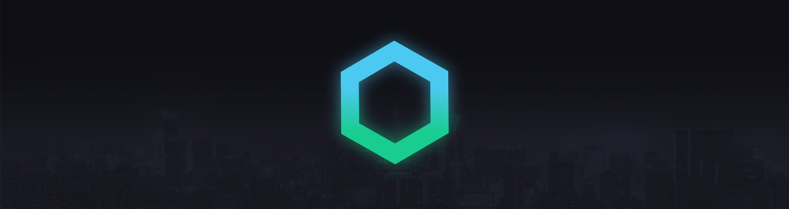
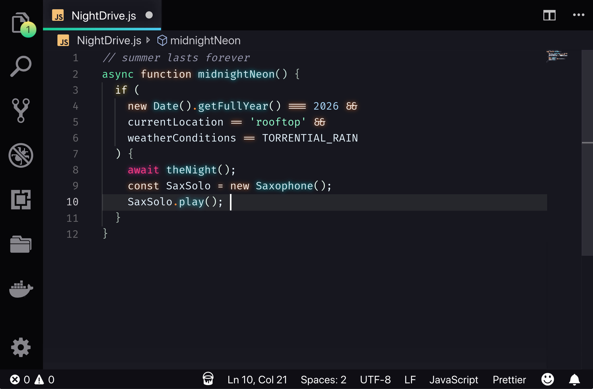

# Midnight Neon - VS Code theme


Midnight Neon is a dark theme built on Synthwave '84. It pairs a deep, near-black navy background with the pastel neon colours of Cyber 77: mint, sky blue, peach and cream yellow. An optional Neon Dreams glow adds green, cyan, pink, orange and yellow neon to your code.



## Installation
To begin with, [install the base theme from the VS Marketplace](https://marketplace.visualstudio.com/items?itemName=JaeHyeokee.midnight-neon-vscode). This is the way Midnight Neon is intended to be used day-to-day. If you want to enable the gratuitous 80s glow, it needs a little extra work to get it going. 

### Disclaimer
VS code doesn't natively support text effects and as a result, the glow is experimental. It's likely to be buggy and, whilst it looks rad, it isn't intended for extended use. To enable the glow, the extension has to modify the internal files of VS Code, so use with caution. Should something go wrong, you can disable the glow by following the instructions below. If for any reason you can't open VS Code, you can fix the issue with a fresh install of VS Code.

If you do decide use the glow effect, you do so at your own risk. Bring your Sunglasses. Here be (laser)dragons.

### To enable the glow
Firstly, if you are a Windows user, you may need to run VS Code with administrator privileges. For Linux and Mac users, Code must not be installed in a read-only location and you must have write permissions.

To activate the glow, set your active colour theme to Midnight Neon. The glow is only active when this theme is selected. Open your command palette with `Ctrl + Shift + P` or `Shift + ⌘ + P` and choose "__Enable Neon Dreams__". It will prompt you to restart, and when you do the lights should be on :)

#### To customise the glow brightness
In your `settings.json` add the key:
```
"midnightNeon.brightness": 0.45
```
The value should be a _float value_ from 0 to 1, where 0.0 is fully transparent. The default brightness is 0.45. To avoid eye strain, avoid using higher brightness values for extended periods of time. 

To see the changes, you need to rerun the activation function. Open your command palette with `Ctrl + Shift + P` or `Shift + ⌘ + P` and choose "__Enable Neon Dreams__".

Note: Changing the brightness currently only affects the opacity of the glow, the text will remain white (that may change in future updates). If you want to disable the glow effect but retain the chrome updates, see below.

#### To enable editor chrome updates, but disable glow
In your `settings.json` add the key:
```
"midnightNeon.disableGlow": true
```
To see the changes, you need to rerun the activation function. Open your command palette with `Ctrl + Shift + P` or `Shift + ⌘ + P` and choose "__Enable Neon Dreams__".

### To remove corruption warning and [unsupported] from title-bar
Because enabling the glow modifies core files, VS code will interpret this as the core being 'corrupted' and you may see an error message on restarting your editor. You can safely dismiss this message, or remove it entirely with the [Fix VSCode Checksums Next](https://marketplace.visualstudio.com/items?itemName=RimuruChan.vscode-fix-checksums-next 'Fix VSCode Checksums Next') extension (a maintained continuation of the original [Fix VSCode Checksums](https://marketplace.visualstudio.com/items?itemName=lehni.vscode-fix-checksums 'Fix VSCode Checksums')).

After installing it, open the command palette and execute `Fix Checksums: Apply`. You will need to completely restart VSCode after execution, reopening without fully exiting might not be enough.

## Updates
Every time you update VS code, you will need to repeat this step to re-enable the glow. Re-run __Enable Neon Dreams__ (and `Fix Checksums: Apply`, if you use it) after each update.

## Disabling the glow and uninstallation
The glow effect is experimental and not intended for long coding sessions. If you want to turn it off, you can disable it at any time by opening your command palette with `Ctrl + Shift + P` or `Shift + ⌘ + P` and choose "__Disable Neon Dreams__".

### Font
No font is bundled with this theme. [Fira Code](https://github.com/tonsky/FiraCode) is recommended if you like ligatures.

## Compatibility
This theme is still **a work in progress**. Some languages may not be highlighted well yet. If you find anything wrong, please [raise an issue](https://github.com/JaeHyeokee/midnight-neon-vscode/issues).

## Contributing
Contributions are welcome. Please read the [contribution guide](https://github.com/JaeHyeokee/midnight-neon-vscode/blob/main/CONTRIBUTING.md) before making changes.

## Credits

- Based on [Synthwave '84](https://github.com/robb0wen/synthwave-vscode) by Robb Owen (MIT License).
- Color scheme from [Cyber 77](https://github.com/CodeReviewer14/Cyber-77-Synthwave-VSCode) by Code Reviewer 14 (MIT License).
- Banner cityscape image from [Unsplash](https://unsplash.com/photos/DxHR8K5Egjk).
